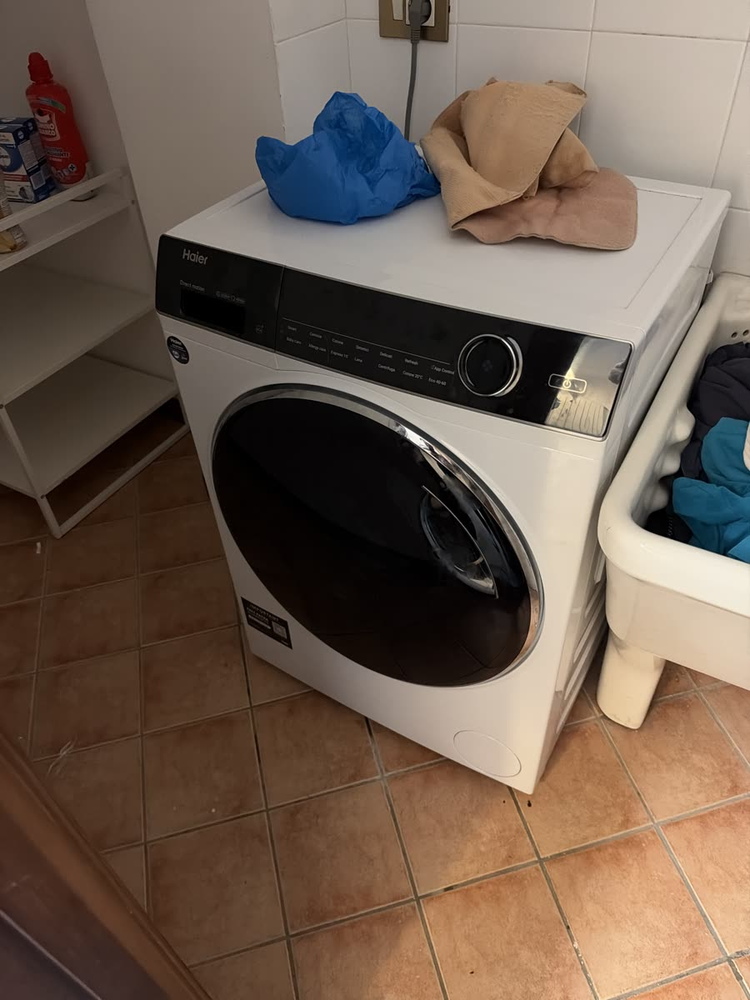
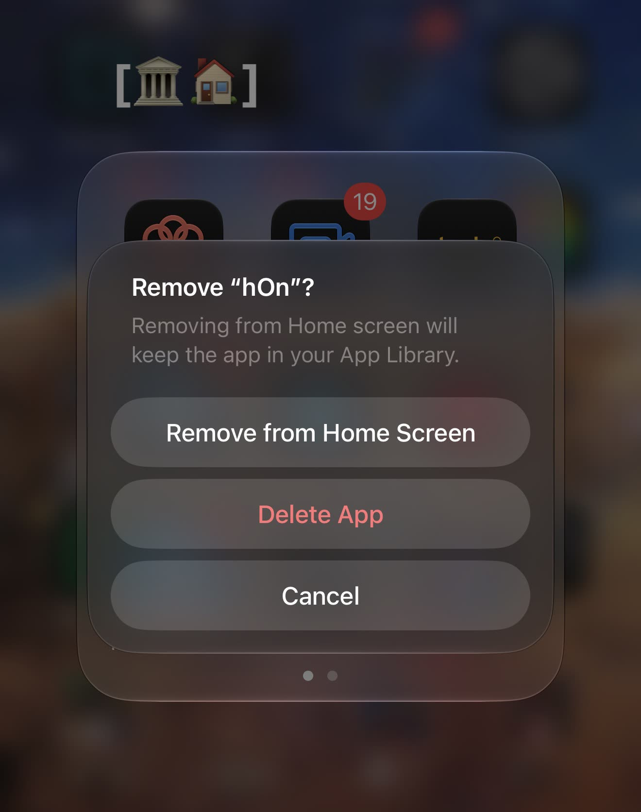
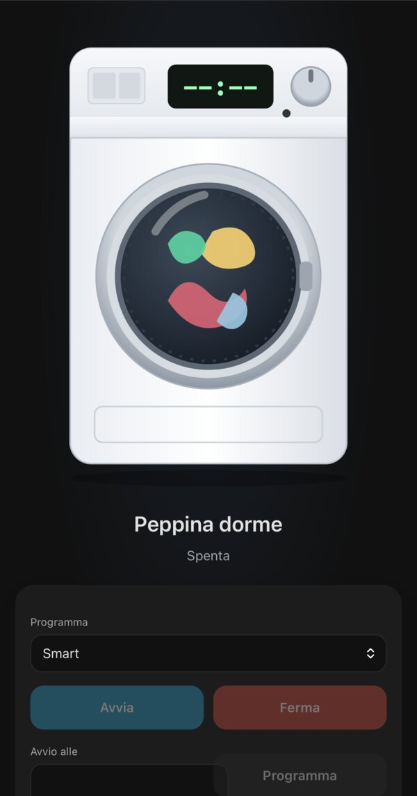
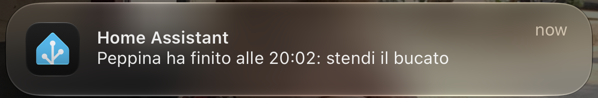

  

# Peppina

**A Home Assistant integration that lets you actually control a hOn washing
machine: start it, stop it, schedule it.**

Haier, Candy and Hoover washers talk to the hOn cloud. The official hOn app
is awful, and it cannot automate anything:
no "finish by 9:00", no "tell me when it's done and keep telling me until I
hang the laundry", no rules at all. The community hOn integrations read the
machine fine, but none of them can **stop** a running program or own a
**delayed start** that Home Assistant schedules itself.

Peppina does both, with no other integration needed. It ships its own small
hOn client (ported from [gvigroux/hon](https://github.com/gvigroux/hon)),
logs in by itself, and gives you a stop button that works.

  
   <em>Where the official app ends up.</em>

## What you get

Peppina polls every appliance that supports both `startProgram` and
`stopProgram` once a minute. For each one it adds a device with:

| Entity | What it does |
|---|---|
| `binary_sensor.peppina_status` | power |
| `sensor.peppina_mode` | raw hOn mode: 1 ready, 2 running, 3 paused, 5 timer, 6 error, 7 done |
| `sensor.peppina_program_name` / `sensor.peppina_program_phase` | running program and its phase |
| `sensor.peppina_remaining_time` / `sensor.peppina_end_time` | minutes left, and when it ends |
| `sensor.peppina_temperature` / `sensor.peppina_spin_speed` | settings of the running program |
| `binary_sensor.peppina_door_status` / `binary_sensor.peppina_remote_control` | door open, remote control enabled |
| `sensor.peppina_error` | hOn error code (`00` = none) |
| `select.<name>_programma` | pick the program to run (remembered across restarts; defaults to the first one) |
| `button.<name>_avvia` | start the selected program now |
| `button.<name>_stop` | stop the running program (and drop any pending delayed start) |
| `datetime.<name>_avvio_ritardato` | start the selected program at that instant |
| `button.<name>_annulla_avvio_ritardato` | drop the pending delayed start |

The delayed start is scheduled by Home Assistant, not by the appliance: a
start that is still in the future survives a restart, and a missed one is
dropped instead of firing late.

The status entities use the same ids and states as the hon integration's, so
their history and the automations built on them carry over when you switch.
A second washer gets the same ids with a `_2` suffix.

### The dashboard

Peppina adds a **Peppina** sidebar dashboard: one full-page card per
appliance, with the machine drawn in SVG next to its controls. The drum turns
while it washes and the whole machine shakes on the spin cycle. It serves no
purpose, and it is the best part.

  

### What you can build on it

Once start, stop and the delayed start are plain entities, the rest is
ordinary Home Assistant automations. These are not part of the integration;
they are what the author runs on top of it:

- **Finish by a deadline.** Loaded in the evening, it is scheduled to finish
  at 09:00, so the laundry does not sit wet all night.
- **Start watchdog.** Five minutes after a planned start, if the machine is
  not washing (door open, hOn refusing, Home Assistant down at the wrong
  moment), send a critical push.
- **Cancel when it cannot work.** If remote control is switched off before
  the delayed start, drop the pending start instead of letting it fail.
- **The nag.** When the cycle ends, send a push every hour until someone taps
  "Stesa" (hung), plus one the moment you walk in the door.

  

## Install

1. Copy `custom_components/peppina` into your `custom_components/`, or add
   this repository to HACS as a custom integration.
2. Restart Home Assistant.
3. Settings → Devices & services → Add integration → Peppina, and log in with
   your hOn app email and password.

The hon integration is not needed. If it is installed, remove it first,
otherwise its entities keep the ids above. Coming from Peppina 0.2, remove
the `peppina:` line from `configuration.yaml`.

The appliance needs remote control enabled on its panel, as it does for the
hOn app.

## Known issues

- `sensor.peppina_program_name` can show "No program" while a cycle started
  from Peppina is running: hOn does not report the program name, and the
  numeric program code it does report is shared by several programs.

## License

MIT
